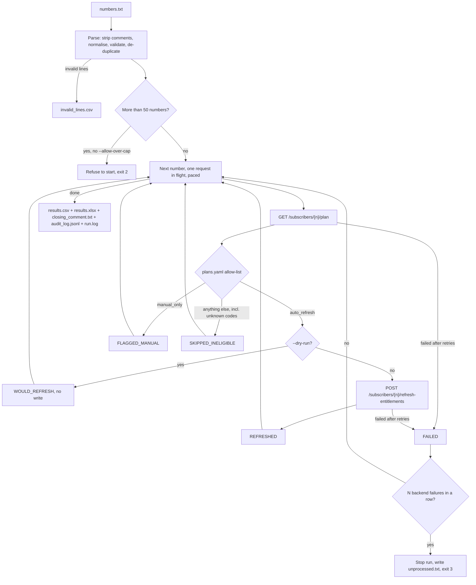
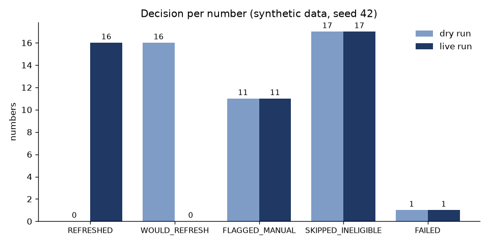
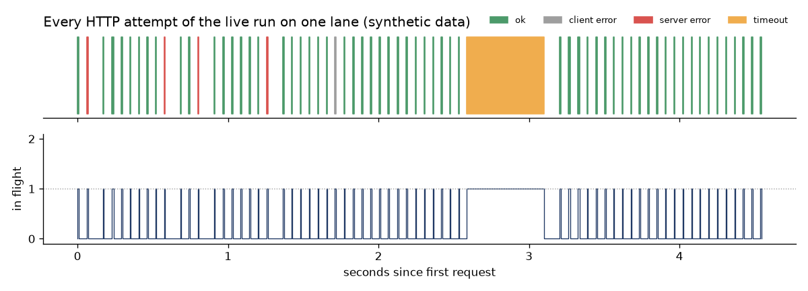

# Safe API batch runner

[](https://github.com/GerasimoskiDesign/safe-api-batch-runner/actions/workflows/ci.yml)

One command that works through a list of subscriber numbers against a live API, one call at a time, with the guardrails needed to run it safely against production.

Rebuilt from scratch on synthetic data. The production version is proprietary.

## The problem

Support kept getting tickets from customers whose subscription perks didn't appear in the app. The fix was manual and repetitive: for each phone number, call one API to check the customer's plan, call a second API to force an entitlement refresh if the plan qualifies, then close the ticket with a note telling the customer to log out and back in. With dozens of numbers per batch this was slow and error-prone, and a script that did it carelessly could flood a production backend.

## What this does

`python -m batchrunner run numbers.txt` reads a hand-collected list of numbers, cleans it, and for each number checks the plan and, only when the plan is on an allow-list, triggers the refresh. Requests go out strictly one at a time with a pause between calls. Retries happen only where they're safe. A circuit breaker stops the run if the backend looks unhealthy. The run produces a report for the support agent and a ticket comment they can paste in.



The retry loop sits inside the client. Timeouts, refused connections, 5xx and 429 are retried with exponential backoff, and a `Retry-After` header is honoured. Any other 4xx is final. A 401/403 stops the whole run, because every following call would fail the same way.

### Before and after

| | Manual workflow (per number) | With the runner (per batch) |
|---|---|---|
| 1 | Copy the number from the ticket | Paste all ticket numbers into one text file, in any common notation |
| 2 | Call the plan API and read the plan code | `python -m batchrunner run numbers.txt --dry-run` to preview the decisions |
| 3 | Decide whether the plan qualifies (from memory or a wiki page) | Decision comes from `config/plans.yaml`, the same for everyone |
| 4 | Call the refresh API if it qualifies | `python -m batchrunner run numbers.txt` |
| 5 | Note the result somewhere | `results.xlsx` and `results.csv`: decision, HTTP status per step, attempts, timestamps |
| 6 | Write a closing comment for the ticket | Paste `closing_comment.txt` (lists the refreshed numbers and tells the customer to log out and back in) |
| 7 | Repeat for the next number | Already done. Only `FLAGGED_MANUAL`, `FAILED` and `unprocessed.txt` need a human |

## Results on synthetic data

All numbers below come from `python -m batchrunner demo` (seed 42) and are **synthetic**. The demo starts the mock API in-process and runs the same 58-line sample input (`data/numbers_sample.txt`) through three scenarios, each against a fresh mock with the same seed:

- **dry-run** checks plans only.
- **live** runs the real workflow with the mock's default fault rates (about 3% 5xx, about 2% responses slower than the client timeout).
- **outage** returns 5xx on every call.

Timings are shortened (0.05 s delay, 0.5 s timeout) so the demo finishes in about 15 seconds. Re-running it produces the same table.

Input after parsing: 58 lines → **45 valid unique numbers**, 4 duplicates (matched after normalising notation), 3 invalid lines, 6 blank/comment lines.

| Metric | dry-run | live | outage |
|---|---:|---:|---:|
| REFRESHED | 0 | 16 | 0 |
| WOULD_REFRESH | 16 | 0 | 0 |
| FLAGGED_MANUAL | 11 | 11 | 0 |
| SKIPPED_INELIGIBLE | 17 | 17 | 0 |
| FAILED | 1 | 1 | 3 |
| numbers not processed | 0 | 0 | 42 |
| HTTP attempts (client) | 50 | 66 | 12 |
| retries | 5 | 5 | 9 |
| calls received (server) | 50 | 66 | 12 |
| write calls received (server) | 0 | 17 | 0 |
| injected 5xx / slow | 4 / 1 | 4 / 1 | 12 / 0 |
| max concurrency seen by server | 1 | 1 | 1 |
| exit code | 1 | 1 | 3 |

What the table shows:

- **The dry run sent zero writes.** That count comes from the mock's own `/admin/stats` counter, not from the runner's bookkeeping.
- **Live run:** all 4 injected 5xx and the 1 timeout were absorbed by retries. 16 refreshes were applied from 17 write calls, because one refresh hit a 5xx and was retried. The single `FAILED` is a number the backend doesn't know (404). It is reported and not retried, because retrying can't fix it. Two of the 17 skipped numbers have a plan code (`PROMO_TRIAL`) that isn't in `plans.yaml`, so the allow-list treats them as ineligible.
- **Outage:** the circuit breaker stopped the run after 3 numbers (12 calls in total) instead of working through all 45. The other 42 numbers are written to `unprocessed.txt` for a later re-run.
- **The server never saw more than one request in flight** in any scenario.





The timeline plots every HTTP attempt of the live run from the audit log. Bars never overlap, and the in-flight count never goes above 1. The wide orange bar is a response the mock held back past the 0.5 s client timeout. The client gave up, the mock saw the disconnect, and the retry went out afterwards.

## Production context

> _Production context: TODO(Mario) — what the real version did and its outcomes, using only publicly shareable facts._

## Safety design

Each guardrail exists because this kind of script runs against **live production systems** that other people depend on.

| Guardrail | What it does | Why it exists |
|---|---|---|
| Strictly sequential | One synchronous `httpx.Client`, connection pool of 1, and a lock that raises if two threads ever use it | A remediation script must never become a load test. Sequential calls also make the audit log a simple, readable timeline |
| Pacing (`--delay`) | Fixed minimum pause between the end of one request and the start of the next | Keeps the load flat and predictable even when every call succeeds instantly |
| Safe retries only | Retries timeouts, refused connections, 5xx and 429, with exponential backoff. Other 4xx are final | Retrying a 404 or 400 just repeats a wrong request. Transient failures usually clear on their own |
| `Retry-After` honoured | Waits at least as long as a 429 asks; gives up if it asks for more than `--max-retry-after` | The backend knows its own capacity better than the client |
| Idempotent writes only | Only the refresh call is ever retried, and refreshing twice equals refreshing once | A timed-out write may or may not have been applied. Retrying is only safe when a duplicate does no harm |
| Per-run cap (50) | Refuses larger inputs unless `--allow-over-cap` is passed | Limits the damage of a wrong input file (for example, a full export pasted by mistake) |
| `--dry-run` | Plan checks only, zero write calls, decisions shown as `WOULD_REFRESH` | Preview a batch against real data before changing anything |
| Allow-list for plans | Only codes listed under `auto_refresh` are written to. Unknown codes are skipped | A new plan nobody has reviewed fails safe |
| Manual-only plans | Shared and business plans are flagged, not refreshed | A forced refresh there can affect other lines, so a human decides |
| Circuit breaker | Stops after N consecutive numbers fail for backend reasons (404s don't count), and writes the rest to `unprocessed.txt` | When the backend is struggling, more calls make it worse |
| Auth failure = stop | 401/403 stops the run after the first call | An expired token would otherwise produce a full list of failures and pointless calls |
| Secrets in `.env` | `BASE_URL` and `API_TOKEN` come from the environment. `.env` is git-ignored. The settings object never prints the token | Credentials don't belong in code, shell history or output files |
| Token redaction | Every log handler redacts the token and masks number-like digit runs, including in tracebacks | A safety net for messages nobody anticipated (for example, an exception that contains a URL) |
| Masked numbers in logs | Logs and the audit log show only the last 3 digits | Logs travel further than reports: chat threads, tickets, log aggregators |
| https only | Refuses plain `http://` unless the host is localhost | The bearer token is sent on every request |
| No redirects | `follow_redirects=False` | The token is never forwarded to another host |
| Per-run output folder | `out/<run_id>/`. The runner refuses to overwrite an existing folder | Stops a stale `closing_comment.txt` from a previous live run from sitting next to today's dry-run |
| Audit log | One JSON line per HTTP attempt, flushed immediately | Even a run killed halfway leaves an exact record of what reached the API |

Exit codes: `0` all processed with no failures, `1` completed with some `FAILED` numbers, `2` refused to start (configuration, input or cap), `3` stopped early (circuit breaker or credentials).

## Quickstart

Requires Python 3.11+.

**Windows PowerShell**

```powershell
git clone https://github.com/GerasimoskiDesign/safe-api-batch-runner.git
cd safe-api-batch-runner
python -m venv .venv
.\.venv\Scripts\Activate.ps1
python -m pip install --upgrade pip
pip install -e ".[dev]"
Copy-Item .env.example .env

# Everything in one go: mock API + dry-run / live / outage scenarios + charts
python -m batchrunner demo

# Tests and lint
pytest
ruff check .
```

**macOS / Linux**

```bash
git clone https://github.com/GerasimoskiDesign/safe-api-batch-runner.git
cd safe-api-batch-runner
python3 -m venv .venv
source .venv/bin/activate
python -m pip install --upgrade pip
pip install -e ".[dev]"
cp .env.example .env

python -m batchrunner demo
pytest
ruff check .
```

**Run it the way an operator would** (two terminals, both with the virtual environment activated):

```bash
# terminal 1: mock API on 127.0.0.1:8000, using API_TOKEN from .env
python -m batchrunner mock-api

# terminal 2: preview, then the real run
python -m batchrunner run data/numbers_sample.txt --dry-run
python -m batchrunner run data/numbers_sample.txt
```

Each run writes to `out/<run_id>/`:

| File | Content |
|---|---|
| `results.csv`, `results.xlsx` | Number, plan, decision, reason, HTTP status and attempts per step, timestamps. The Excel file is colour-coded and adds Summary and Invalid input sheets |
| `closing_comment.txt` | Ready-to-paste ticket comment for the refreshed numbers (live runs only) |
| `summary.json` | Counts per decision, retries, write attempts, why the run stopped |
| `audit_log.jsonl` | Every HTTP attempt (masked number, status, error, backoff) |
| `run.log` | The console log (masked) |
| `invalid_lines.csv`, `unprocessed.txt` | Only written when there are invalid lines or the run stopped early. `unprocessed.txt` can be fed straight back into `run` |

Useful flags: `--delay`, `--timeout`, `--max-attempts`, `--backoff-base`, `--max-numbers`, `--allow-over-cap`, `--breaker-threshold`, `--out-dir`. See `python -m batchrunner run --help`. The mock's fault rates, slow-response duration and rate limit are set by flags on `mock-api` (see `--help`).

## Project structure

```
safe-api-batch-runner/
├── .github/workflows/ci.yml     ruff + pytest on every push
├── config/plans.yaml            11 plan codes: auto_refresh / manual_only / everything else ineligible
├── data/numbers_sample.txt      seeded synthetic input (+999 numbers, duplicates, invalid lines, comments)
├── docs/img/                    charts generated by `python -m batchrunner demo`
├── src/batchrunner/
│   ├── cli.py                   commands: run, mock-api, generate-numbers, demo
│   ├── numbers.py               parse, normalise, validate, de-duplicate input
│   ├── config.py                .env settings (https rule) and plan allow-list
│   ├── client.py                sequential HTTP client: pacing, retries, Retry-After
│   ├── breaker.py               consecutive-failure circuit breaker
│   ├── runner.py                per-number workflow and decisions, cap
│   ├── pipeline.py              one full run: input -> API -> outputs, exit codes
│   ├── reports.py               CSV, Excel, closing comment, summary, audit log
│   ├── masking.py               number masking and token redaction for logs
│   ├── logging_setup.py         redacting console/file handlers
│   ├── mock_api.py              FastAPI mock: seeded faults, rate limit, /admin/stats
│   ├── mock_server.py           run the mock on a free local port in a thread
│   ├── generate.py              seeded generator for the sample input
│   ├── demo.py                  reproducible dry-run / live / outage scenarios
│   └── charts.py                README charts
├── tests/                       pytest, against the mock over real HTTP
├── .env.example                 dummy BASE_URL / API_TOKEN
└── pyproject.toml
```

## Design decisions & trade-offs

- **Synchronous on purpose.** An async client would be faster, but "one request at a time" is the requirement, and a synchronous client with a pool of one can't accidentally fan out. The concurrency guarantee is checked from the outside: the mock counts the requests it is handling at the same moment, and a control test proves that counter does detect parallel calls.
- **Tests use real HTTP.** The mock runs under uvicorn on a free port, so timeouts, client disconnects and concurrency are real. Pure retry logic is also tested with a scripted in-memory transport and a fake clock, so backoff schedules are checked exactly without waiting.
- **The mock notices a client hanging up.** A slow response stops as soon as the client disconnects. Otherwise the server would still count an abandoned request while the retry arrives, and report concurrency 2 when the client never had two requests open. A real backend may well keep processing an abandoned request, which is another reason the backoff after a timeout is never zero.
- **No jitter in backoff.** Jitter helps when many clients retry at once. This is a single sequential client, and a fixed schedule keeps runs reproducible.
- **The breaker counts numbers, not attempts, and ignores 404s.** A 404 means the backend answered correctly about a number that doesn't exist, which says nothing about backend health. There is no half-open state: a batch run that trips just ends, and the operator re-runs `unprocessed.txt` later.
- **`WOULD_REFRESH` is a fifth decision for dry runs.** Reusing `REFRESHED` would make a dry-run report look like a live one, and no closing comment is written for a dry run.
- **Full numbers in the report, masked numbers in logs.** The report goes to the agent who closes the tickets and needs the numbers. Logs go everywhere, so they keep only the last three digits.
- **Determinism.** The input generator and the mock's fault injection use seeds, and the runner is sequential, so the same seed gives the same decisions, retries and table. Recorded timestamps are wall-clock and change between runs. The workflow has no business-date logic, so there is no `--as-of` flag.
- **Limitations.** The mock's rate limiter is a simple minimum gap between accepted calls, and its `Retry-After` is in whole seconds. There is no check that the perk actually appeared after a refresh. The ticket comment is copy-paste, not posted through a ticketing API. `FAILED` numbers have to be re-run by hand (only numbers that were never reached go into `unprocessed.txt`).
- **What I'd do next:**
  - Add a verify step that re-reads entitlements after the refresh.
  - Add a `--resume <run_id>` that re-queues `FAILED` and unprocessed numbers.
  - Integrate with the ticketing system to post the comment.
  - Add a shared rate budget if several operators ever run batches against the same backend at the same time.

## Tech stack

Python 3.11 · httpx · FastAPI + uvicorn (mock API) · python-dotenv · PyYAML · openpyxl · matplotlib · pytest · ruff · GitHub Actions
